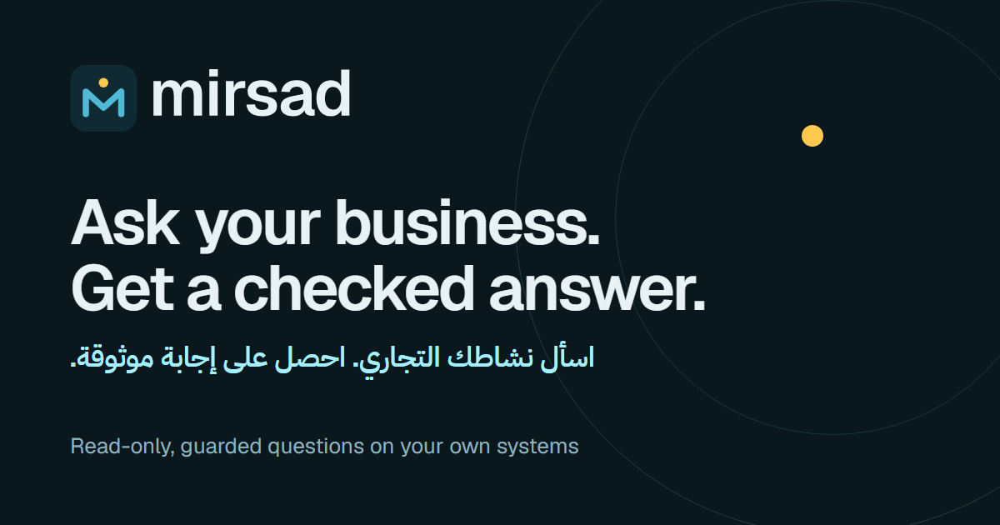
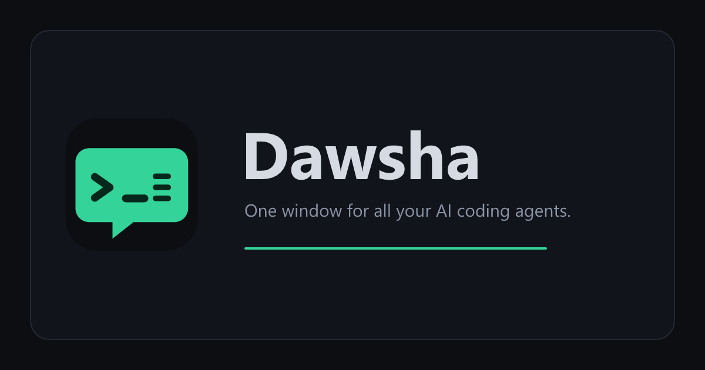
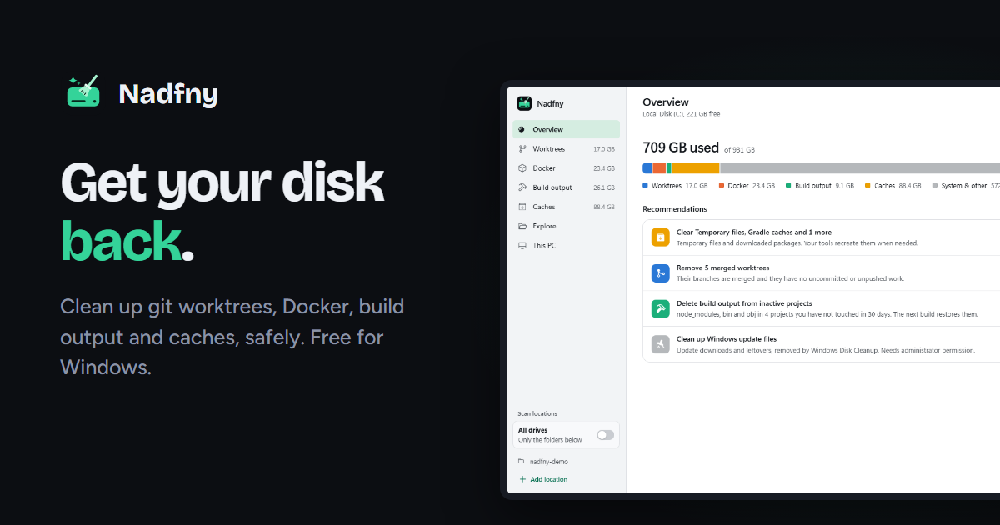
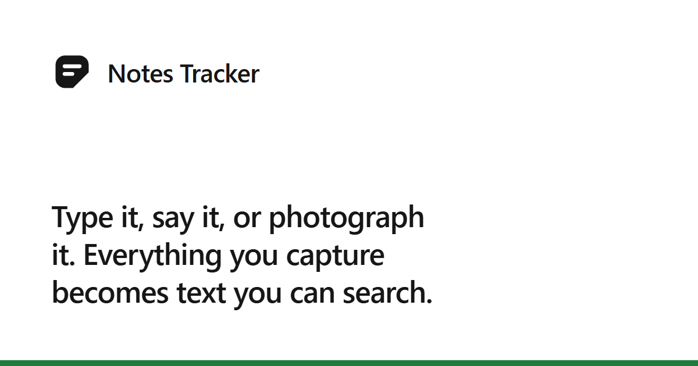
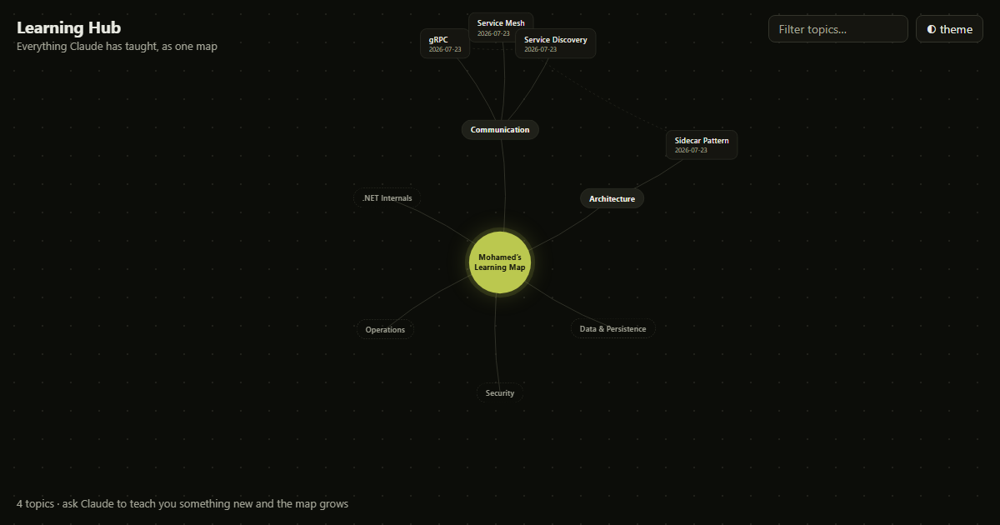

<h1>Mohamed Fathy</h1>

  <b>.NET Tech Lead</b> · Multi-tenant SaaS architecture · Microservices · Blazor · Angular 
  Cairo, Egypt · Open to remote and to relocation with visa sponsorship

  <a href="cv/Mohamed-Fathy-CV.pdf"><b>Download my CV (PDF)</b></a> ·
  <a href="mailto:mohamedfathy234@gmail.com">mohamedfathy234@gmail.com</a> ·
  <a href="tel:+201113312949">+20 111 331 2949</a>

I design and lead enterprise platforms on the Microsoft stack. For the last 3+ years I have led the architecture of a
multi-tenant cloud ERP built as .NET 10 microservices: tenant lifecycle and data isolation, identity on Keycloak,
licensing, event-driven integration and observability, with the frontend in Blazor WebAssembly and Angular. Outside
work I build tools I want to use myself, and ship them.

## Projects

<table>
  <tr>
    <td width="50%" valign="top">
      
      <h3><a href="https://assistant-console.pages.dev">Mirsad</a></h3>
      An AI assistant that answers business questions in Arabic or English from any SQL database or REST API.
      Every generated query passes a guard, a permission check and tenant scoping before it runs, and an on-premises
      connector reaches private data over outbound HTTPS only.  
      .NET 10 · Microsoft.Extensions.AI · React · Angular &amp; Blazor widgets · SignalR · Docker 
      <a href="https://assistant-console.pages.dev">Website</a> · <a href="https://github.com/mfathy234/mirsad-connector">Connector releases</a>
    </td>
    <td width="50%" valign="top">
      
      <h3><a href="https://github.com/mfathy234/dawsha">Dawsha</a></h3>
      Runs Claude Code, Codex CLI and Gemini CLI side by side in large, readable terminals, one session per task, with
      agent timelines, file review, remote control from a phone and in-app updates. Windows, macOS and Linux.  
      Electron · TypeScript · xterm.js · node-pty · Vite · Playwright 
      <a href="https://dawsha.pages.dev">Website</a> · <a href="https://github.com/mfathy234/dawsha">Source</a> · <a href="https://github.com/mfathy234/dawsha/releases/latest">Download</a>
    </td>
  </tr>
  <tr>
    <td width="50%" valign="top">
      
      <h3><a href="https://github.com/mfathy234/nadfny">Nadfny</a></h3>
      A fast Windows disk cleaner for developers. Finds the space lost to git worktrees, Docker, build output and
      package caches, with guards that never delete unsaved work or source code, live progress and a self-updating
      installer.  
      .NET 10 · WebView2 · WiX · xUnit 
      <a href="https://nadfny.pages.dev">Website</a> · <a href="https://github.com/mfathy234/nadfny">Source</a> · <a href="https://github.com/mfathy234/nadfny/releases/latest">Download</a>
    </td>
    <td width="50%" valign="top">
      
      <h3><a href="https://notes-tracker.pages.dev">Notes Tracker</a></h3>
      A cross-platform notes app for Windows, Android and the web with offline sync, voice notes with speech-to-text,
      text extraction from images, shared notebooks and a full Arabic right-to-left interface.  
      .NET 10 · .NET MAUI · Blazor · ASP.NET Core · PostgreSQL · SQLite 
      <a href="https://notes-tracker.pages.dev">Website</a>
    </td>
  </tr>
  <tr>
    <td width="50%" valign="top">
      
      <h3><a href="https://github.com/mfathy234/learning-hub">Learning Hub</a></h3>
      A personal knowledge base of self-contained engineering lessons, browsable as an animated, searchable mind map
      of how the topics connect.  
      HTML · CSS · JavaScript · GitHub Pages 
      <a href="https://mfathy234.github.io/learning-hub/">Live map</a> · <a href="https://github.com/mfathy234/learning-hub">Source</a>
    </td>
    <td width="50%" valign="top">
      <h3>More on GitHub</h3>
      <ul>
        <li><a href="https://github.com/mfathy234/mirsad-connector"><b>mirsad-connector</b></a>: releases of the Mirsad on-premises connector for Windows and Docker, with SHA-256 checksums.</li>
        <li><a href="https://github.com/mfathy234/mt-license-manager"><b>mt-license-manager</b></a>: license and subscription records manager. Next.js, Prisma, Postgres.</li>
        <li><a href="https://github.com/mfathy234/DCSA"><b>DCSA</b></a>: a .NET web solution from 2022.</li>
        <li><a href="https://github.com/mfathy234/docs"><b>docs</b></a>: a documentation site.</li>
        <li><a href="https://github.com/mfathy234/Projects"><b>Projects</b></a> and <a href="https://github.com/mfathy234/IP-FCIS"><b>IP-FCIS</b></a>: university work at Ain Shams, including RSA encryption, games and image processing.</li>
      </ul>
    </td>
  </tr>
</table>

## Experience

**Technical Lead / Principal .NET Engineer**, MicroTec, Cloud ERP SaaS for the Saudi market · *Jan 2024 – present*
- Lead the architecture of a multi-tenant ERP built as .NET microservices on Clean Architecture, CQRS and DDD; designed the multi-tenancy layer and led the upgrade to .NET 10 / EF Core 10.
- Architected tenant lifecycle management (version pinning, controlled rollouts, migrations, dedicated-database isolation) and licensing across services.
- Own identity on Keycloak (custom themes and providers, multi-account sign-in, v23 to v26 migration) and event-driven integration with RabbitMQ/MassTransit and the Outbox pattern.
- Established platform observability (OpenObserve, Sentry, Elastic) and lead frontend architecture across Blazor WebAssembly and an Angular monorepo; cut stylesheet code by 43–85% per app with a design-token system.

**.NET Developer**, MicroTec · *Jun 2023 – Dec 2023*. Core ERP modules on .NET microservices and Angular; promoted to Technical Lead within seven months.

**.NET Web Developer**, ACS Software House · *Jan 2017 – May 2023*. ASP.NET applications for GIZ, the Ministries of Health and Education, NCCM and the Federation of Egyptian Industries, and payment integrations with Fawry, QNB, PayPal, E-Finance, Moyasar and Apple Pay.

The [CV](cv/Mohamed-Fathy-CV.pdf) has the full project list.

## Stack

| | |
| --- | --- |
| **Backend** | C# · .NET 10 / ASP.NET Core · EF Core · Clean Architecture · CQRS · DDD · Microservices · Multi-tenancy · RabbitMQ / MassTransit · Hangfire · Redis |
| **Identity** | Keycloak · OAuth 2.0 / OpenID Connect · JWT · Permission-based authorization |
| **Frontend** | Blazor WebAssembly · MudBlazor · .NET MAUI · Angular · PrimeNG · TypeScript · Design systems |
| **Data** | SQL Server · PostgreSQL · Oracle · MySQL · SQLite |
| **Cloud & DevOps** | Azure DevOps · Azure Container Apps · Docker · Cloudflare Pages · OpenObserve · Sentry · Elastic |
| **Practices** | xUnit · bUnit · Playwright · Code review · Technical leadership · AI-assisted engineering |

**Education:** B.Sc. Computer and Information Science, Ain Shams University (2016). 
**Languages:** Arabic (native), English (fluent).
